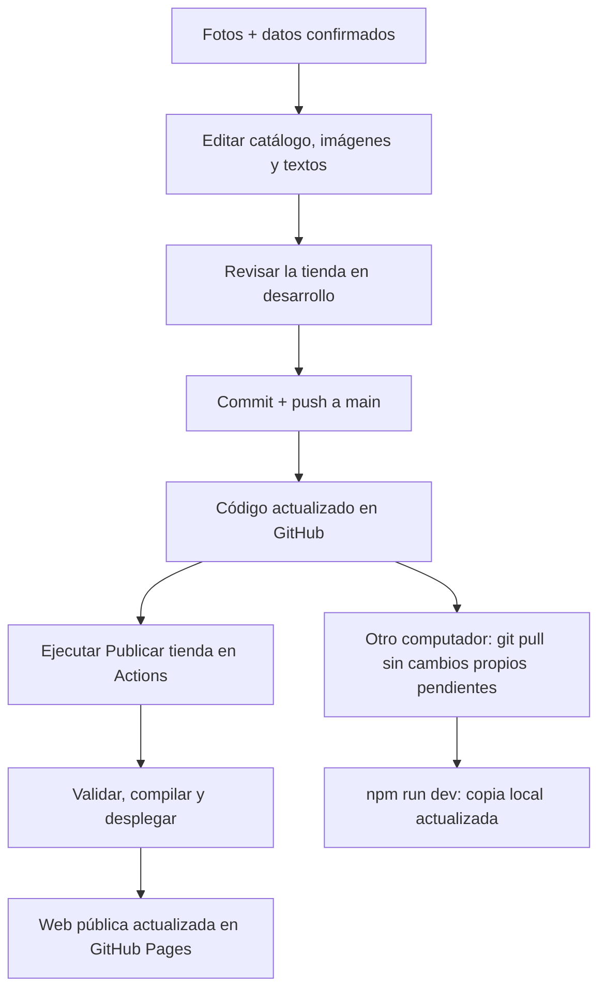

# ⚡ Pokénova TCG

Pokénova TCG es una tienda en desarrollo dedicada a productos de Pokémon: cartas, sobres, ETB, peluches, figuras, accesorios y otros artículos para jugar, coleccionar o regalar.

La página permite explorar el catálogo y preparar consultas por **WhatsApp**. La atención de la tienda se realiza al **+56 9 1111 1111**; allí se confirman el precio vigente, la disponibilidad y el envío.

> **Estado actual:** el catálogo contiene productos, precios y existencias de demostración. Las imágenes actuales son referenciales. Antes de ofrecer productos reales, debemos incorporar sus fotos y confirmar sus datos.

📖 Para instrucciones de edición paso a paso, consulta el [Manual de edición de Pokénova](MANUAL.md).

## 🛍️ ¿Qué incluye la tienda?

| Sección o función | Qué permite hacer |
| --- | --- |
| Portada | Presentar la tienda con colores inspirados en Pokémon, personajes y acceso al catálogo. |
| Catálogo | Explorar cartas, productos sellados, peluches y accesorios. |
| Búsqueda y filtros | Encontrar productos por texto y categoría, y ordenarlos por precio. |
| Ficha del producto | Ver su foto principal, descripción y precio. |
| Carrito de consulta | Reunir varios artículos y preparar un mensaje de WhatsApp. |
| Compramos tus cartas | Ofrecer challa, cartas sueltas, lotes y productos sellados a la tienda. |
| Quiénes somos | Contar la historia y el propósito de Pokénova. |
| Contacto | Consultar directamente por WhatsApp. |

El diseño se adapta a celulares, tablets y computadores. El fondo incluye colores y brillitos con movimiento suave, y respeta la preferencia del sistema de **reducir movimiento**. El mismo símbolo de Pokénova aparece en el encabezado, el pie de página y el icono de la pestaña.

### ¿Cómo funciona el carrito?

1. El cliente agrega productos y ajusta las cantidades.
2. Al pulsar **Consultar mi pedido**, se abre WhatsApp con un mensaje que incluye los artículos y el total de ejemplo.
3. El carrito se vacía en ese navegador al abrir la consulta.
4. El cliente debe enviar el mensaje en WhatsApp para que la tienda lo reciba.

Si consulta un artículo desde su ficha, se elimina **solo ese artículo** del carrito; los demás se conservan. Antes de consultar, el carrito se guarda en el navegador y se mantiene al recargar la página.

**La consulta no realiza un pago ni reserva productos.** Tampoco descuenta inventario automáticamente. La tienda confirma el pedido y el envío durante la conversación.

### ¿Cómo funciona «Compramos tus cartas»?

Quien quiera vender challa, cartas o productos sellados puede enviar fotos, cantidades, ediciones y detalles del estado por WhatsApp. La tienda revisa el material y conversa una oferta; esta sección no promete una tasación fija ni una compra automática.

## 📸 Enviar productos para incorporarlos

Puedes adjuntar las fotos en este chat y enviar una ficha por producto:

```text
Acción: agregar / actualizar / retirar
Nombre del producto:
Categoría: cartas / sellados / peluches y figuras / accesorios
Precio de venta en CLP:
Unidades disponibles:
Descripción:
Foto principal: indicar cuál, si adjuntas varias
Etiqueta opcional: Nuevo / Destacado / otra
```

Para cartas, incluye la expansión, el número, el idioma y el estado. Para productos sellados, indica edición, idioma y estado del sello. Para peluches, figuras y accesorios, agrega tamaño o medidas si corresponde.

Identifica las fotos con el nombre del producto. Actualmente cada ficha muestra **una foto principal**; si envías varias, indica cuál prefieres. Una galería requeriría ampliar la ficha.

Para una actualización pequeña, basta con algo como: «Peluche Eevee: cambia la foto por la adjunta, el precio es $18.990 y quedan 3 unidades». Ese importe es un ejemplo de cómo comunicar el cambio, no un precio confirmado de la tienda.

Con los datos confirmados podemos preparar los archivos, revisar el resultado y subir el contenido a GitHub. La publicación de la web se ejecuta después, como se explica más abajo.

## 🧭 Dónde editar cada cosa

Actualmente la tienda se mantiene mediante archivos; todavía no tiene un panel de administración ni una base de datos.

| Quiero cambiar… | Archivo o carpeta |
| --- | --- |
| Productos, precios, cantidades y descripciones | [`src/catalog.js`](src/catalog.js) |
| Fotos de los productos | [`public/images/`](public/images/) |
| Número de WhatsApp | [`src/site.config.js`](src/site.config.js) |
| Portada, textos del catálogo, Quiénes somos y pie de página | [`src/App.jsx`](src/App.jsx) |
| Sección de compra de challa y productos sellados | [`src/Buyback.jsx`](src/Buyback.jsx) |
| Colores, tamaños, diseño y animaciones | [`src/styles.css`](src/styles.css) |
| Símbolo del logo e icono de pestaña | [`public/favicon.svg`](public/favicon.svg) |
| Título de pestaña y descripción para buscadores | [`index.html`](index.html) |
| Flujo de publicación | [`.github/workflows/pages.yml`](.github/workflows/pages.yml) |

Para una foto guardada en `public/images/mi-producto.jpg`, la ficha debe usar:

```js
image: '/images/mi-producto.jpg',
```

Subir la foto por sí sola no crea el producto. También hay que agregar o actualizar su ficha en `src/catalog.js`. Usa nombres de archivo en minúsculas, sin espacios ni tildes, y respeta su extensión.

El precio se escribe como número en pesos chilenos, sin símbolo ni separadores: para $24.990, usa `price: 24990`. La cantidad es un entero: `stock: 3`.

**Si está agotado:** `stock: 0` impide agregar unidades al carrito, pero mantiene el producto visible y permite consultar por WhatsApp. Para retirarlo del catálogo, elimina su ficha. Actualiza manualmente el stock cuando confirmes una venta.

El [manual](MANUAL.md) incluye un ejemplo completo de producto, las categorías disponibles y cómo editar textos, fotos, logo y colores.

## 💻 Arrancar la página en Windows

Necesitas **Node.js 24**, que incluye npm. Instala también **Git** si vas a clonar el repositorio o actualizarlo con `git pull`.

Los siguientes comandos están escritos para la terminal **Símbolo del sistema (CMD)** de Windows. Ejecútalos uno a la vez.

### 1. Entrar en la carpeta

Si ya tienes el proyecto en tu carpeta de Descargas:

```bat
cd /d C:\Users\X1\Downloads\pokenova_tcg
```

Si tu terminal ya muestra `C:\Users\X1\Downloads\pokenova_tcg>`, ya estás en el lugar correcto. Si lo guardaste en otra ubicación, usa esa ruta.

Si todavía no tienes el repositorio, puedes clonarlo desde Descargas y luego entrar en él:

```bat
cd /d C:\Users\X1\Downloads
git clone https://github.com/PaulaNarvaez/pokenova_tcg.git
cd pokenova_tcg
```

### 2. Instalar y arrancar

La primera vez, ejecuta:

```bat
npm ci
npm run dev
```

`npm ci` instala las dependencias del proyecto respetando las versiones guardadas. `npm run dev` inicia la página de desarrollo.

Abre la dirección que muestre la terminal, normalmente `http://localhost:5173/`. Si ese puerto está ocupado, usa la dirección que indique Vite. Mantén la terminal abierta mientras trabajas.

Al guardar una edición, la página se actualiza. Para detener el servidor, presiona **Ctrl + C**.

En las próximas sesiones, dentro de la carpeta del proyecto, basta con:

```bat
npm run dev
```

### 3. Recibir cambios que ya subimos a GitHub

Si tienes una copia clonada con Git y **no tienes ediciones propias pendientes**, detén el servidor y ejecuta:

```bat
git pull
npm run dev
```

Si cambió `package-lock.json`, ejecuta `npm ci` antes de arrancar. Si Git informa de cambios propios o un conflicto, conserva tus archivos y comparte el mensaje para integrar ambas versiones.

Una carpeta descargada como ZIP no incluye el historial de Git y no se actualiza con `git pull`. Para trabajar con esas actualizaciones, clona el repositorio usando Git o la opción **Clone repository** de GitHub Desktop.

## ✅ Revisar antes de publicar

Comprueba que las fotos carguen, que los datos sean correctos y que los botones de WhatsApp preparen el mensaje esperado. Revisa la página tanto en celular como en computador.

| Comando | Para qué sirve |
| --- | --- |
| `npm test` | Comprueba la lógica del catálogo y del carrito. |
| `npm run test:e2e` | Revisa flujos de la página con un navegador automatizado. |
| `npm run build` | Compila la web y genera los archivos de publicación en `dist/`. |
| `npm run preview` | Permite revisar esa compilación localmente; requiere ejecutar antes `npm run build`. |

Para preparar el navegador de las pruebas en otra máquina:

```bat
npx playwright install chromium
npm run test:e2e
```

En el entorno de la nube, Playwright también puede utilizar `/usr/bin/chromium` si está disponible, o la ruta indicada mediante `PLAYWRIGHT_CHROMIUM_EXECUTABLE_PATH`.

Si una prueba falla después de editar datos o comportamiento, revisa el mensaje antes de publicar. El flujo de GitHub Pages ejecuta `npm test`; un fallo impide desplegar esa nueva versión.

## 🚀 Subir el código y publicar la web

Hay tres lugares que conviene distinguir:

| Lugar | Qué muestra | Cómo se actualiza |
| --- | --- | --- |
| Tu computador | Tu copia local de desarrollo. | Guardas tus cambios o ejecutas `git pull`, y arrancas con `npm run dev`. |
| Repositorio de GitHub | Los archivos y su historial de cambios. | Subes un commit a `main`. |
| Web pública de GitHub Pages | La tienda que pueden visitar los clientes. | Ejecutas el flujo **Publicar tienda** y esperas a que termine correctamente. |



### Subir archivos a GitHub

Si editas por tu cuenta, puedes usar **GitHub Desktop** para revisar los cambios, crear el commit y pulsar **Push origin**. También puedes editar un archivo desde GitHub con el botón del lápiz o subir fotos en `public/images/` mediante **Add file → Upload files**.

Si hacemos los cambios en este chat, podemos preparar y subir la actualización al repositorio. Confirma que los nuevos archivos aparezcan en la rama `main` antes de publicar la web.

### Publicar con GitHub Pages

El flujo [**Publicar tienda**](.github/workflows/pages.yml) se ejecuta manualmente:

1. **La primera vez:** en GitHub, abre **Settings → Pages** y selecciona **GitHub Actions** como origen de publicación.
2. Después de subir los cambios a `main`, abre **Actions → Publicar tienda → Run workflow**.
3. Selecciona `main` y ejecuta el flujo.
4. Espera a que finalicen correctamente los trabajos de compilación y publicación.
5. Abre la dirección que GitHub muestre en **Settings → Pages** o en el despliegue y revisa los cambios.

**Para cada nueva versión pública, vuelve a ejecutar el flujo.** Tener el código actualizado en GitHub no confirma que la web pública se haya actualizado.

Arrancar la página con `npm run dev` muestra la copia de desarrollo. Configurar o publicar el entorno de Codex prepara el espacio de trabajo en la nube; la publicación de la tienda para los clientes se realiza con GitHub Pages.

GitHub Pages proporciona una dirección pública para la tienda. Un dominio propio es opcional y requiere su configuración aparte.

### Compilación para otros alojamientos

El flujo de Pages utiliza `VITE_BASE_PATH=/pokenova_tcg/` porque el sitio se aloja bajo esa subruta. Para un alojamiento que sirva la tienda desde la raíz de un dominio, utiliza `npm run build` con la base predeterminada y publica la carpeta `dist/`.

## 📝 Datos reales y convenciones del proyecto

- **Catálogo de muestra:** los precios CLP y las existencias de `src/catalog.js` son demostrativos hasta que confirmemos el inventario real. Incorporar una foto propia no convierte los demás datos en información comercial confirmada.
- **Fotos:** las imágenes de personajes actuales son ilustraciones, no fotografías de los peluches disponibles. Las fuentes están registradas en [`public/images/assets-sources.json`](public/images/assets-sources.json).
- **Paso a productos reales:** al confirmar fotos, precios y cantidades, debemos sustituir los ejemplos y ajustar los avisos de catálogo, precio, subtotal y fotografías referenciales. El manual explica ese paso.
- **Atención:** se utiliza únicamente WhatsApp. El precio final, la disponibilidad y el envío se confirman con la tienda.
- **Commits:** la autora es **PaulaNarvaez**. Los títulos deben llevar la hora y fecha reales de Chile, en la zona `America/Santiago`, con formato `HH:mm:ss · DD-MM-YYYY`.
- **Credenciales:** no guardes archivos `.env` ni credenciales en Git. Esta primera versión no necesita una base de datos ni claves de una API de precios.

Las instrucciones para trabajar en el repositorio están en [`AGENTS.md`](AGENTS.md). La aplicación utiliza React y Vite; la instalación de dependencias accede a `registry.npmjs.org`. Las imágenes se sirven desde el propio proyecto y los enlaces de atención abren WhatsApp.

Hecho con ❤️. Pokénova TCG es un proyecto independiente. Pokémon y sus marcas pertenecen a sus respectivos titulares.
